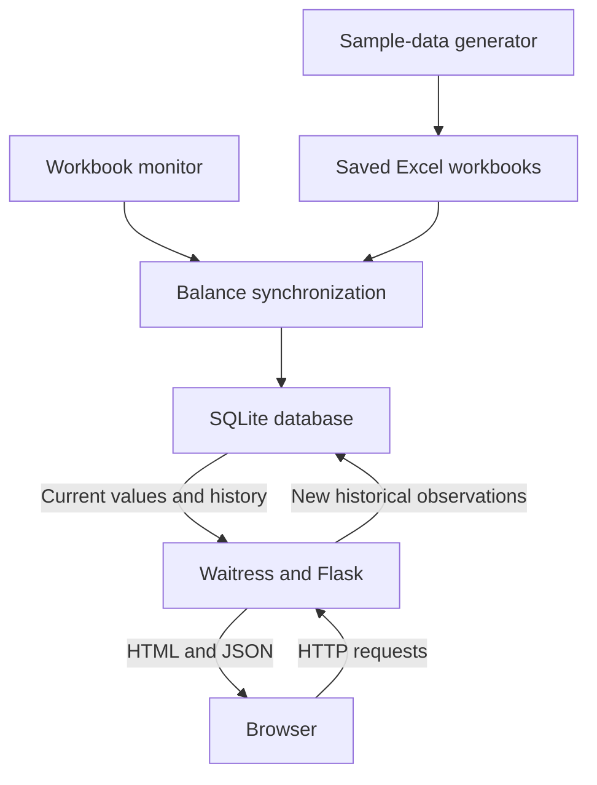

# TPA Operations Dashboard — Architecture

This document explains the components, data flow and design decisions of the anonymized portfolio edition. For installation and startup commands, see [README.md](README.md). For schemas, API behavior and implementation details, see [technical.md](technical.md).

## 1. System overview

The dashboard brings balances from three Excel workbooks into a single browser view. A monitoring process reads saved workbook values and updates a local SQLite database. A separate Flask application serves current balances and historical observations through Waitress.

Both Python processes run on the same computer and share `src/TPA_Operations.db`. The documented demonstration binds Waitress to `127.0.0.1:5002`, so it is accessible from that computer only. Running `historical_dashboard.py` directly instead uses Flask's development server on port 5001.

The original business use case involved continuous balance visibility on departmental display screens. That is deployment context, rather than evidence that a shared or production deployment is included in this repository.

## 2. Component relationships

The database is shared by the ingestion and web processes. The browser does not read Excel or SQLite directly. HTTP requests both retrieve information and, for the history endpoint, can cause an observation to be written.

## 3. Components and responsibilities

| Component | File | Responsibility |
| --- | --- | --- |
| Demonstration setup | `src/create_sample_data.py` | Generates three explicitly fictional workbooks |
| Ingestion | `src/sync_balances.py` | Reads and validates E4; updates current balances and check metadata |
| Scheduling and retries | `src/watch_balances.py` | Detects file changes and triggers ingestion |
| Application and presentation | `src/historical_dashboard.py` | Handles web requests, records observed changes and supplies the embedded frontend |
| Storage | `src/TPA_Operations.db` | Stores current balances, monitoring metadata and observations |

The sample-data generator is a setup tool. It does not need to remain running and does not create the database or historical readings.

## 4. Ingestion flow

1. The watcher inspects each configured workbook's modification time.
2. It calls `sync_company()` at startup, after a detected modification, or when a periodic recheck is due.
3. Synchronization reads the configured worksheet's E4 value in read-only mode and closes the workbook.
4. A numeric value is written to the current-KPI table. The same database transaction updates the successful-check and workbook-modification timestamps.
5. Only a successful synchronization updates the watcher's in-memory tracking state. Failed reads can therefore be retried on later iterations.

The watcher sleeps for three seconds between passes and schedules a periodic recheck after sixty seconds without a successful check. These are polling intervals, not guaranteed delivery times: file access, database contention and processing can add delay.

One company's successful transaction does not depend on all three companies being available. If a later read fails, an older successful balance can remain visible.

## 5. Browser and history flow

The browser requests `/api/history` on page load, when a client or period is selected, and every three seconds.

For each valid request, Flask reads the current values for all configured companies. It compares each value with its most recent stored history entry. A first observation or a sufficiently different value is appended to history. The application then returns current balances for all companies and history for the selected company and period.

**History collection is request-driven.** The monitor updates current balances but does not independently append observations. Changes while no browser or other API client is requesting data can be missed. Intermediate changes between requests can also be missed. History is an observation series, not a complete ledger of business transactions or a scheduled daily snapshot system.

## 6. Storage boundaries

| Table | Owner of writes | Purpose |
| --- | --- | --- |
| `CEO_KPIs` | Synchronization | Latest value for each configured KPI |
| `KPI_Monitor` | Synchronization | Most recent successful check and source modification time |
| `TPA_Balance_History` | History endpoint | Changes observed during API requests |

The `CEO_KPIs` name is retained in the public implementation and referenced by both scripts. Renaming it requires coordinated changes. There is no separate database server or migration framework.

## 7. Design choices and tradeoffs

| Choice | Benefit | Tradeoff |
| --- | --- | --- |
| Read saved Excel values | Fits an existing workbook workflow without modifying source files | Depends on saved values and formula caches |
| Separate watcher and server | Data collection can continue while the web server is stopped | Two processes must be managed; history still depends on requests |
| Local SQLite file | Simple installation and persistence | Concurrent writers can contend; observation insertion is not protected against races |
| Polling | Straightforward behavior and retries | Updates are detected after a delay and require repeated checks |
| Embedded HTML, CSS and JavaScript | Compact distribution without a frontend build | A large Python file mixes presentation and backend logic |
| Localhost serving | Simple local demonstration | Does not provide remote viewing or a shared deployment solution |

The application reads local files. Any synchronization of cloud-backed folders would happen outside these scripts; no SharePoint or OneDrive API client is included.

## 8. Current boundaries and future work

The public edition has generic company labels and fictional examples. It does not include login, HTTPS, email alerts, currency conversion or direct browser editing of balances.

A connected status indicates that a browser request succeeded; it does not establish source freshness. Monitoring timestamps are stored but not currently presented in the UI. GET requests can write history, and simultaneous requests may create duplicate observations.

Potential next changes are to move historical writes into ingestion transactions, make the API read-only, display stale-source indicators, standardize timestamps and externalize configuration. Authentication and transport protection would need a separate design before shared network deployment. These are proposed improvements, not implemented features.

## 9. Validation evidence

The developer manually tested the local Windows demonstration through sample generation, synchronization and Waitress serving. On 3 November 2026, a fictional Company A balance was changed from 50,000 to 48,000; the developer confirmed successful automatic updating, and the dashboard showed the new balance and two connected history observations.

This supports the demonstrated local end-to-end scenario. It does not establish load capacity, unattended production reliability or complete failure-mode coverage.
